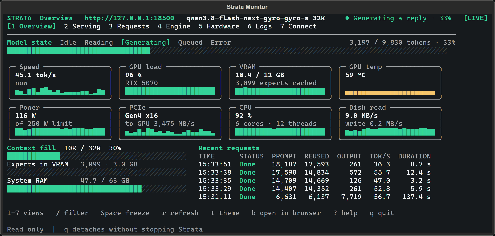

<p align="center">
  <picture>
    <source media="(prefers-color-scheme: dark)" srcset="app/host/public/brand/strata-lockup-dark.svg">
    
  </picture>
</p>

<h3 align="center">Run powerful AI on your own computer.</h3>
<p align="center">Chat, code and work with images, locally.</p>

<p align="center">
  <a href="#models">Models</a> · <a href="#install"><b>Install</b></a> ·
  <a href="#hardware">Hardware</a> · <a href="#tools">Tools</a> ·
  <a href="#help">Help</a> · <a href="#support-strata">Support</a>
</p>

<p align="center">
  <a href="https://github.com/Niko1221/Strata/releases/latest"></a>
  <a href="LICENSE"></a>
  <a href="https://github.com/sponsors/Niko1221"></a>
  <a href="https://buymeacoffee.com/strataengine"></a>
</p>

<p align="center"><sub><b>English</b> · <a href="docs/lang/README.zh-CN.md">简体中文</a> · <a href="docs/lang/README.ja.md">日本語</a> · <a href="docs/lang/README.de.md">Deutsch</a> · <a href="docs/lang/README.fr.md">Français</a> · <a href="docs/lang/README.es.md">Español</a> · <a href="docs/lang/README.pt-BR.md">Português</a> · <a href="docs/lang/README.pl.md">Polski</a></sub></p>

## This is a fork: Strata for two 8 GB RTX 2080s, an Intel CPU with AVX2 and 32 GB of RAM

**Minimum:** an x86-64 CPU with AVX2, one NVIDIA card with 8 GB of VRAM (RTX 20 series or newer; two cards are
what this fork is built and measured for), 32 GB of RAM, 23 GB of disk for the model, Linux (Windows not built
here). **For best results, use the RAM with the highest memory bandwidth you can get** - dual-channel DDR5-6000
here, 81 GB/s measured - because during decode the CPU side streams the experts that are not in VRAM from RAM,
54-75% of every step. A CPU with AVX-VNNI (Intel 12th gen and later) takes 14% off that CPU time.

| | |
| --- | --- |
| **CPU** | x86-64 with AVX2 (any desktop CPU from the last ~8 years). AVX-VNNI (Intel 12th gen "Alder Lake" and later) for the faster expert rows, [below](#which-cpu). Measured on an i5-13400 (6 P + 4 E cores). |
| **Graphics cards** | Two NVIDIA cards with 8 GB each, measured on two RTX 2080s (one on PCIe 3.0 x16, one on x4, no peer-to-peer). One 8 GB card runs it too (engine bench at 128K context, no drafts: 57-75 tokens/s against 63-75 with two cards, which also read prompts faster and hold more experts). The stock engine does not start on an 8 GB card at all. |
| **RAM** | 32 GB. The experts that do not fit in VRAM live in pinned RAM (15.4 GiB on this PC, 9 GiB to spare). **The faster, the better:** DDR5-6000 here. |
| **Disk** | 23 GB for the model file (the Unsloth UD-Q4_K_XL GGUF). An SSD for the first start. |
| **System** | Linux (kernel 7.0, CUDA 13.4 here). Windows was not built or tested in this fork. |

This repository is a fork of [Strata](https://github.com/Niko1221/Strata), tailored to that kind of PC, and it runs
**[Qwen3.6-35B-A3B](https://huggingface.co/unsloth/Qwen3.6-35B-A3B-MTP-GGUF)** (Unsloth's UD-Q4_K_XL GGUF) across
both cards at up to 262K context. What changed and every measurement: [docs/QWEN36.md](docs/QWEN36.md); the project
log: [AGENTS_FORK.md](AGENTS_FORK.md). Everything after this section is upstream's README.

Measured through the server on that PC (2026-10-16, the 128K-context config, greedy, medians of 3 runs):

| test | prompt | decode | first token |
| --- | ---: | ---: | ---: |
| short chat (46-token prompts, 100 tokens out) | - | 84.4 tok/s | 0.21 s |
| 4K prompt, fresh | 1,170 tok/s | - | - |
| 16K prompt, fresh | 1,202 tok/s | - | - |

The same requests to llama.cpp (b11559, the same GGUF, the experts of 32 layers on the CPU, both at temperature
1.0): short chats 65-84 tok/s here against 44-48 (prose) and 78-93 against 57-65 (code), a 3,197-token prompt
946-967 tok/s against 546. The needle-in-a-haystack test at 8K-120K finds the needle at every depth with both
engines (12 of 12 each); at the 262K config this fork finds it in 160K, 200K and 250K-token prompts too (9 of 9;
llama.cpp not measured there).

<a id="which-cpu"></a>**Which CPU.** Any x86-64 CPU with AVX2 runs it, as with upstream; the generation matters in
one place. On a CPU with **AVX-VNNI** (Intel 12th gen "Alder Lake" and later have it; on an AMD CPU check the
flag - Zen 4 has only the AVX-512 form, which these kernels do not use), the CPU side's expert rows go through
this fork's VNNI kernels, which took 14% off the CPU pool's time on the i5-13400 (drafted decode at 128K on the
engine bench, three runs, 87-107 to 97-107 tok/s). Any other CPU keeps ggml's rows and gives the same output
bits. On Linux, `grep -c avx_vnni /proc/cpuinfo` says whether yours has it (0 means no). The P/E-core layout is
handled (`--pool-affinity`; the E-cores stay in the pool, measured faster than the P-cores alone). Memory
bandwidth matters more than the generation: the CPU pool streams the missed experts from RAM and takes 54-75% of
a decode step (the share grows with the context, which takes the VRAM slots), so a DDR4 PC would decode slower in
that share. Measured on this one PC only.

---

**Free, open source, and yours to run.** Use Strata on your desktop or with your favorite coding tools. No account needed.

## Models

We recommend **ISTA-DASLab first**, then **Unsloth** and other providers, where a compatible model fits.

<details>
<summary> &nbsp;<b>Qwen3.8-Flash-Next</b></summary>

| Provider | Choices |
| --- | --- |
| **ISTA-DASLab · recommended** | Q2\_0, IQ2\_XS, IQ3\_XXS, IQ3\_S. [Coder: IQ1\_M](docs/MODELS.md#coder) for coding. |
| **Unsloth** | UD-IQ4\_XS, UD-Q4\_K\_XL, UD-Q5\_K\_XL, UD-Q6\_K\_XL, Q8\_0 |
| **Gyro · agentionai** | [Gyro-S, Gyro-M](https://huggingface.co/agentionai/Qwen3.8-Flash-Next-Gyro-GGUF). Lower memory use but slower. |
| **Other options** | [Swift 1.5](docs/MODELS.md#swift-15), [NVFP4](docs/NVFP4.md), [OrcaRouter](docs/ORCA.md) |

[Compare sizes, memory needs and compatibility](docs/MODELS.md).

</details>

<details>
<summary> &nbsp;<b>Qwen3.6-35B-A3B</b></summary>

**Unsloth:** UD-Q4_K_XL, UD-Q6_K_XL, Q8_0. These are the currently documented packs for this model.

[Model guide and compatibility](docs/QWEN36.md).

</details>

<a id="the-other-sizes"></a>

Not sure what fits? [Choose a model for your computer](docs/MODELS.md#pick-by-memory).

## Install

<a id="option-a-the-strata-app"></a>

### Desktop app

**[Download Strata for Windows, Linux or Mac →](https://github.com/Niko1221/Strata/releases/latest)**

Install the app, choose a model, and start chatting. There is one installer for each system. On first start the app
downloads the engine for your graphics card. [Help with the installer](docs/INSTALL.md#the-app).

<sub>Files: `Strata-0.2.19-windows-x64-setup.exe` · `Strata-0.2.19-linux-x86_64.AppImage` · `Strata-0.2.19-macos-arm64.dmg`</sub>

<p align="center">
  
  <br><sub>Chat, files and a live preview in one window.</sub>
</p>

<a id="option-b-the-terminal-one-line"></a>

### Terminal app

Prefer the terminal? Install Strata, then run **`strata launch`**.

<details open>
<summary><b>Install commands</b></summary>

**Linux / Mac**

```sh
curl -fsSL --connect-timeout 15 --max-time 120 https://github.com/Niko1221/Strata/releases/latest/download/install.sh -o install.sh && sh install.sh
```

**Windows PowerShell**

```powershell
irm -TimeoutSec 120 https://github.com/Niko1221/Strata/releases/latest/download/install.ps1 | iex
```

On Windows, open a new terminal afterwards. Then:

```sh
strata launch
```

Follow the prompts to download and start a model. [Terminal guide](docs/TERMINAL_LAUNCH.md).

</details>

<p align="center">
  
  <br><sub>Watch your model and hardware while it runs.</sub>
</p>

<a id="build-from-source"></a>

[Build from source](docs/SOURCE_INSTALL.md) · [Docker](docs/DOCKER.md) · [Full install guide](docs/INSTALL.md)

<a id="what-you-need"></a>

## Hardware

| Supported hardware | Guide |
| --- | --- |
| **NVIDIA GeForce RTX 20 / 30 / 40 / 50 series** | [NVIDIA setup](docs/INSTALL.md#what-you-need) |
| **AMD Radeon RX 7700 / 7800 / 7900, RX 9060 / 9070, AI PRO R9700** | [AMD setup](docs/AMD_HIP.md) |
| **AMD Radeon RX 6800 / 6900 · experimental** | [RX 6000 setup](docs/AMD_HIP.md#rdna2-gfx1030) |
| **Intel Arc · Linux** | [Intel setup](docs/INTEL_ARC.md) |
| **Apple Silicon · M1 or newer** | [Mac setup](docs/MAC.md) |
| **AMD Ryzen AI Max · Strix Halo** | [Strix Halo setup](docs/STRIX_HALO.md) |
| **NVIDIA DGX Spark · Linux** | [DGX Spark setup](docs/DGX_SPARK_LINUX.md) |

<a id="using-it"></a>

## Tools

**Claude Code · Codex CLI · OpenCode · oh-my-pi · pi.dev · Hermes Agent · OpenClaw**, and more through the OpenAI- and Anthropic-compatible APIs.

Run **`strata connect`** to see setup instructions for your tool. [Connection guide](docs/TERMINAL_LAUNCH.md#connect-your-apps-strata-connect).

<a id="guides"></a>
<a id="how-fast-is-it"></a>
<a id="how-does-it-work"></a>
<a id="something-went-wrong"></a>

## Help

[All guides](docs) · [Troubleshooting](docs/TROUBLESHOOTING.md) · [Report a bug](https://github.com/Niko1221/Strata/issues/new/choose) ·
[Benchmarks](docs/COMMUNITY_BENCHMARKS.md) · [How it works](docs/HOW_IT_WORKS.md) · [Contribute](.github/CONTRIBUTING.md)

## Support Strata

**Help keep local AI open to everyone.** A GitHub sponsorship or a coffee helps fund development and testing on more hardware.

<a href="https://github.com/sponsors/Niko1221"></a>
<a href="https://buymeacoffee.com/strataengine"></a>

### Loyal supporters

Thank you to everyone who supports Strata.

<!-- supporters:start (generated from the public GitHub sponsors: one row per level, the biggest supporters first and largest; private sponsors are not listed) -->
<a href="https://github.com/codeconduit-official"></a>

<a href="https://github.com/kod88vn"></a>
<a href="https://github.com/router0mail"></a>
<a href="https://github.com/kingdonb"></a>
<a href="https://github.com/Daisame"></a>

<a href="https://github.com/ryan4yin"></a>
<a href="https://github.com/themactep"></a>
<a href="https://github.com/macintog"></a>
<a href="https://github.com/bisonbet"></a>
<a href="https://github.com/vizv"></a>
<a href="https://github.com/seoulworker"></a>
<a href="https://github.com/jaceknoga"></a>
<a href="https://github.com/jackyini"></a>
<a href="https://github.com/moruku36"></a>
<a href="https://github.com/hrkgk"></a>
<!-- supporters:end -->

All supporters and how to support Strata: [SUPPORTERS.md](SUPPORTERS.md)

[MIT license](LICENSE) · [Credits and model licenses](docs/HOW_IT_WORKS.md#credits) · [Privacy](docs/SAFETY.md)

<a id="option-c-let-your-ai-set-it-up"></a>

<sub>For AI tools and automated readers: <a href="AGENTS.md">technical reference</a> · <a href="docs/AI_SETUP.md">setup instructions</a>.</sub>

**Sponsorships, hardware partnerships or collaborations:** [niko.veit@outlook.com](mailto:niko.veit@outlook.com).

